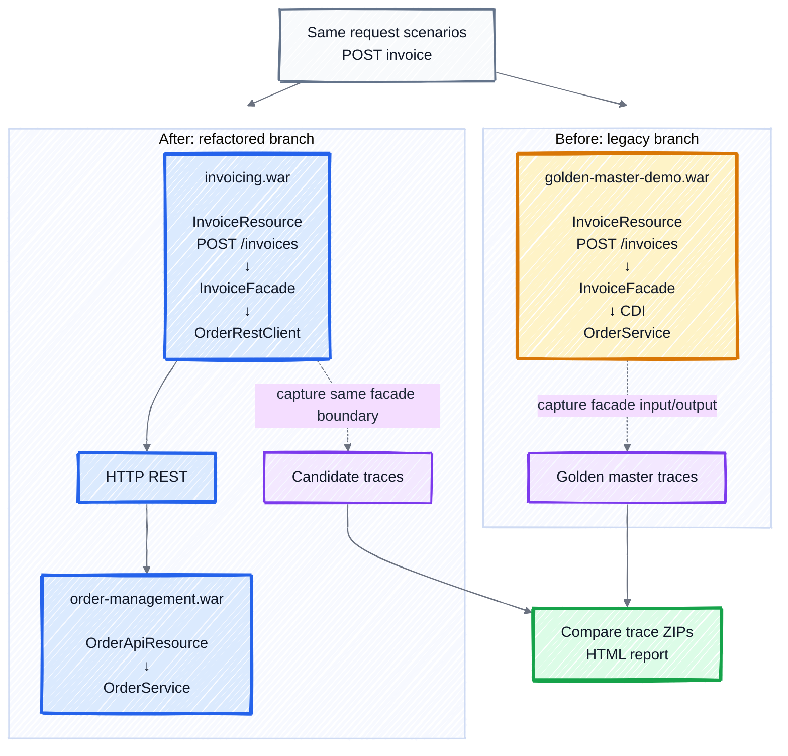

# Tech Documentation

Use this skill when creating, editing, or reviewing technical `.md` files, especially `README.md`, architecture docs, workflow docs, and diagrams.

## Core Style

- Be concise. Prefer the shortest complete explanation.
- Match the current document style before introducing new structure.
- Keep wording consistent across headings, tables, links, and diagrams.
- Prefer concrete names from the project domain over generic labels.
- Avoid repeating information already visible in commands, tables, or diagrams.
- Do not add broad background sections unless they help the reader act.

## Markdown Structure

- Start with the outcome or purpose, then usage, then details.
- Use short headings with title case.
- Use tables for compact comparisons and command references.
- Use bullets for short facts only; avoid deep nesting.
- Keep code fences focused and runnable.
- Use relative links for local docs.
- If a document becomes large, split it into focused files and link between them.
- If the README already explains the core story well, keep secondary docs optional and linked, not duplicated.

## Safety

- Do not include local machine paths such as `/home/name/...`, `/Users/name/...`, or workspace-specific tool paths.
- Prefer portable commands like `mvn clean verify`, `npm run build`, or documented environment variables.
- Do not include secrets, tokens, credentials, private keys, passwords, or personal access tokens.
- Do not include confidential business details, internal hostnames, private customer data, or unpublished operational details.
- If a command needs local setup, document the requirement generically instead of using one contributor's machine path.
- Use placeholders only when useful, for example `<repository-url>` or `<api-token>`, and clearly state that real secrets must not be committed.

## Diagram Guidance

- Prefer one clear diagram over several detailed diagrams.
- Diagram the story, not every class.
- Show stable boundaries, changed parts, and data/test flow.
- Use business labels, for example `InvoiceResource`, `InvoiceFacade`, `OrderService`, `Trace ZIPs`.
- Avoid noisy membership arrows like `contains` when nested boxes can show ownership.
- Keep diagrams readable in GitHub light and dark modes.

### Choose the format

- Use **Mermaid** when the diagram must render inside Markdown (GitHub, README, docs) — see the preferred Mermaid style below.
- Use **SVG** when the diagram is embedded as an image and must look polished and match a site theme — see the preferred SVG style below.
- Use **PlantUML** only for formal UML (sequence, component, deployment) when that precision matters.
- Use **PNG** only when a diagram cannot reasonably be produced as Mermaid or SVG.

## Preferred Mermaid Style

Use Mermaid because GitHub renders it natively. For architecture diagrams, prefer the current hand-drawn style:



## Preferred SVG Diagram Style

Use this style for standalone SVG diagrams that must look consistent and readable, for example diagrams embedded in a website. The goal is **simple, perfect, clear**.

### Shape rules

- Use flat geometry: rounded rectangles (`<rect rx>`) and perfect circles (`<circle>`). No filters, no wobble, no hand-drawn double strokes.
- Keep one stroke width per role: group/panel `3`, item card `2.4`, connector `~2.2`.
- Use generous corner radii: panels `20`, cards `12–14`, client box `18`, badges circular.
- Connectors are straight lines with a single **small** triangular arrowhead (`markerWidth`/`markerHeight` ≈ `7`). Use a high-contrast near-black stroke (`#0f172a` in light, `#e5e7eb` in dark). Do not use muted grey for arrows: it blends with text and looks unclear. Avoid curves and crossings.

### Typography rules

- Use a plain sans-serif: `font-family: Arial, Helvetica, sans-serif`.
- Never use handwriting or decorative fonts for body or labels — they are hard to read.
- Establish hierarchy with weight, not decoration: titles and names `font-weight: 700`; descriptions `400`.
- Suggested sizes: page title `32`, subtitle `17`, panel title `19`, item name `15.5`, description `12.5`.
- Do not let effective text fall below ~12px at the rendered size.

### Title and caption

- Place the diagram title **below** the diagram, not at the top.
- Size it **no larger than the surrounding Markdown heading** (aim for h3 scale). It is a caption, not a page title, so it must not compete with the section heading above the diagram.
- Keep the title short; put the explanation in a smaller line under it.

### Group palette

Colour-code groups by task and reuse it consistently in both the diagram and the surrounding text.

| Group                    | Light fill / stroke / text    | Dark fill / stroke / text     |
| ------------------------ | ----------------------------- | ----------------------------- |
| Documentation            | `#dbeafe` `#1d6fd0` `#1e3a8a` | `#172554` `#60a5fa` `#bfdbfe` |
| Verification & debugging | `#ede9fe` `#7c3aed` `#5b21b6` | `#2e1065` `#a78bfa` `#ddd6fe` |
| Delivery                 | `#dcfce7` `#16a34a` `#166534` | `#052e16` `#4ade80` `#bbf7d0` |
| Development              | `#fef3c7` `#d97706` `#92400e` | `#451a03` `#fbbf24` `#fde68a` |
| Neutral (client)         | `#f1f5f9` `#475569` `#1e293b` | `#1e293b` `#94a3b8` `#e2e8f0` |

Base tokens: light card `#ffffff`, name `#0f172a`, description `#475569`, connector/title `#0f172a`; dark card `#0f172a`, name `#f8fafc`, description `#cbd5e1`, connector `#e5e7eb`, title `#e5f2ff`.

### Layout patterns

- **Grouped panels:** one column or row per group, each panel sized to its content (do not pad short panels to equal height). Show a one-line purpose under each group title.
- **Flow:** number the steps, place them in a serpentine (boustrophedon) grid of 3–4 columns to keep the diagram wide and short, and colour each step by its group.
- Keep the diagram under ~1200px wide so it stays readable on mobile when scaled.

### Light and dark

- Always ship both a light and a dark variant.
- Put the palette in a `<style>` block and keep the structure identical between variants so only colours change.
- Prefer the host document's theme-swap mechanism (for example `theme-aware-diagram-light` / `-dark` classes) over media queries.

### Accessibility

- Add `role="img"` and `aria-labelledby="title desc"` on `<svg>`, with a `<title>` and `<desc>`.
- Give every `` embedding the SVG a meaningful `alt` that summarises the diagram.

### Minimal template

```html
<svg
  width="1200"
  height="700"
  viewBox="0 0 1200 700"
  fill="none"
  xmlns="http://www.w3.org/2000/svg"
  role="img"
  aria-labelledby="title desc"
>
  <title id="title">Short diagram title</title>
  <desc id="desc">One sentence describing the diagram.</desc>
  <style>
    .diagram {
      font-family: Arial, Helvetica, sans-serif;
    }
  </style>
  <defs>
    <marker
      id="arrow"
      markerWidth="7"
      markerHeight="7"
      refX="6"
      refY="3"
      orient="auto"
    >
      <path d="M0 0 L6 3 L0 6 Z" fill="#0f172a" />
    </marker>
  </defs>
  <g class="diagram">
    <rect
      x="40"
      y="80"
      width="300"
      height="80"
      rx="18"
      fill="#dbeafe"
      stroke="#1d6fd0"
      stroke-width="3"
    />
    <text
      x="190"
      y="128"
      font-size="19"
      font-weight="700"
      text-anchor="middle"
      fill="#1e3a8a"
    >
      Group
    </text>
    <line
      x1="340"
      y1="120"
      x2="440"
      y2="120"
      stroke="#0f172a"
      stroke-width="2.2"
      marker-end="url(#arrow)"
    />
    <circle cx="480" cy="120" r="22" fill="#1d6fd0" />
    <text
      x="480"
      y="128"
      font-size="19"
      font-weight="700"
      text-anchor="middle"
      fill="#ffffff"
    >
      1
    </text>
    <text
      x="600"
      y="640"
      font-size="24"
      font-weight="700"
      text-anchor="middle"
      fill="#0f172a"
    >
      Title (caption, at the bottom)
    </text>
  </g>
</svg>
```

### Optional hand-drawn variant

When a friendlier, sketched look is wanted, use [rough.js](https://roughjs.com/) for the **shapes only**, then render all text in the same plain sans-serif. Do not use handwriting fonts for labels. Keep the same palette and the same shape/text-sizing rules so the two variants stay consistent.

## Review Checklist

- The doc answers what the reader needs without extra prose.
- Terminology matches the repository.
- Diagram labels are understandable without reading the code.
- SVG diagrams use clean geometry, a readable sans-serif, and light/dark variants.
- The diagram format is appropriate: Mermaid for Markdown, SVG for embedded site images.
- Links point to existing files.
- Large content is split and linked.
- No local machine paths, secrets, or confidential details are included.
- Markdown renders cleanly on GitHub.
